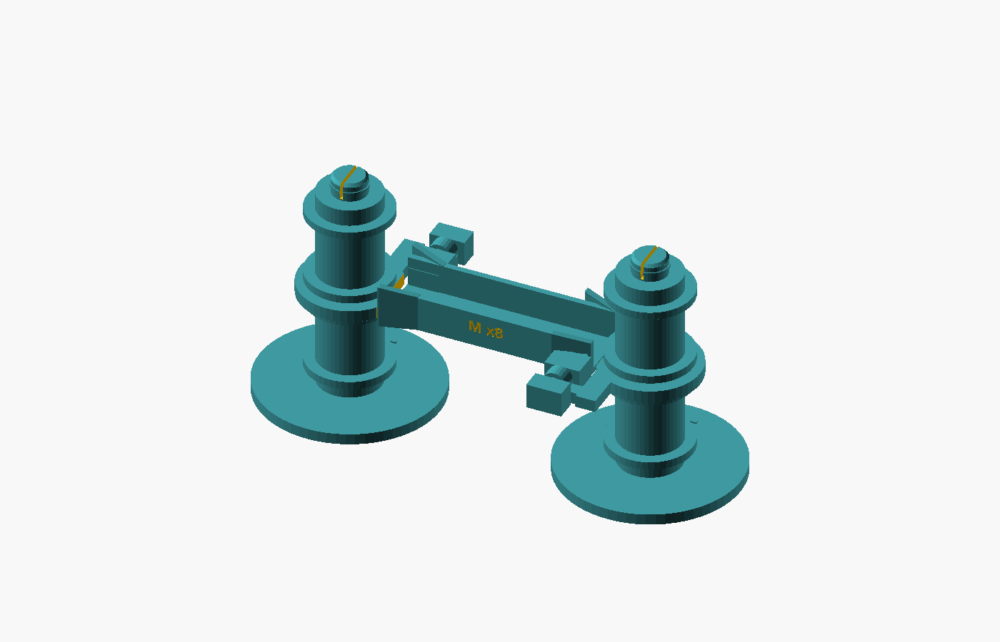
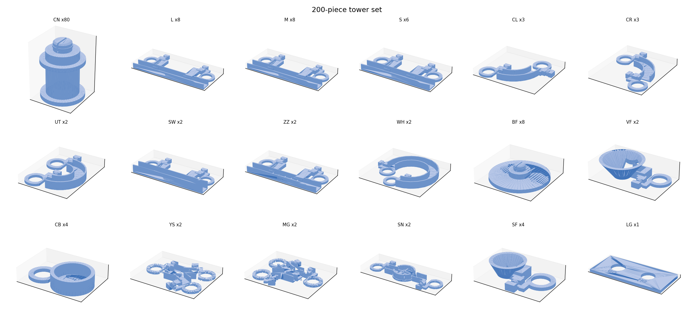
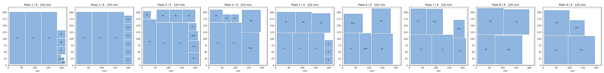

# Tower marble run

A printable 200-piece marble run. Clear cylinders stack into towers. Each track has a ring on the end. The ring slides down over a cylinder, and the next cylinder locks it on. Hang one end of a track lower than the other and the marble runs.

The published set is 80 connectors, 36 tracks, 60 glow marbles, and 24 other pieces. This is original geometry of that system. It does not use their logo or copy their booklet. The page does not list how the 36 tracks and 24 other pieces are split up, so those counts follow the features it does name: straight tracks, curves, swoops, a whirl, vortex funnels, a catch, a split, a merge, and a spinner.

## Which ball to use

Use a **16 mm ball**. Buy 60. Glow-in-the-dark glass is the match for switching the lights off. A plain 16 mm glass marble runs the same track.

| Ball | Use it? |
| --- | --- |
| 16 mm glass marble | Yes. This is the default. |
| 5/8 in (15.875 mm) steel ball bearing | Yes. Heavier, so it holds speed on a steep drop. |
| Anything else | No. A 14 mm marble falls through the gauge. A 25 mm toy marble does not fit. |

Check every ball with `LG`:

- **GO, 16.7 mm.** The ball must fall through.
- **NO-GO, 15.5 mm.** The ball must sit on top.

A good 16 mm marble and a 5/8 in bearing both pass. The channel is 19.6 mm wide, so anything from about **15.6 mm to 16.6 mm** rolls without jamming.

`LG` is a tool. It is not one of the 200 pieces.

## The pieces

Marks are printed on the parts. `L x8` means eight of that piece in the full set.

### Connectors

| Mark | Count | What it is |
| --- | --- | --- |
| `CN` | 80 | Short column segment. 28 mm tall and 24 mm across, so a tower looks like stacked bands. |
| `BF` | 8 | Square foot. Start every tower on one. |

### Tracks (36)

| Mark | Count | What it is |
| --- | --- | --- |
| `L` | 8 | Long straight. Columns 156 mm apart when the chute is level. |
| `M` | 8 | Medium straight. 128 mm. |
| `S` | 6 | Short straight. 100 mm. The piece used for the close hops. |
| `CL` | 3 | 90° curve, left. |
| `CR` | 3 | 90° curve, right. |
| `UT` | 2 | 180° U-turn. |
| `SW` | 2 | Swoop. 110 mm, taller walls. |
| `ZZ` | 2 | Straight with floor bumps. The marble clicks as it rolls. |
| `WH` | 2 | 270° whirl. |

An 8 in chute plus both rings does not fit a 220 mm bed, so `L` is the longest straight that does. One tower level over `L` is about 19°. The towers stand closer than the level length once the chute tilts.

### The other 24

| Mark | Count | What it is |
| --- | --- | --- |
| `BF` | 8 | Feet, listed again because they are part of the 24. |
| `VF` | 2 | Big funnel. Drop a marble in the top, or dump a track into it. |
| `SF` | 4 | Small starter funnel. |
| `CB` | 4 | Catch cup. End of a run. |
| `YS` | 2 | Split. One in, two out. |
| `MG` | 2 | Merge. Two in, one out. |
| `SN` | 2 | Spinner. A captive paddle wheel. |
| | **24** | |

80 connectors + 36 tracks + 24 others = 140 printed pieces. Add the 60 marbles and the set is 200.

## How it goes together

1. Stand a `BF` foot on the table.
2. Slide a track ring down over the peg until it sits on the neck.
3. Press a `CN` onto the peg. The bottom lip of the connector traps the ring. The ring can still spin, so you can aim the track.
4. Stack more connectors. Each one adds **28 mm**.
5. Clip the other ring onto a second tower.

The hinges let the chute tilt while the rings stay level. The height difference is the slope.

The chute pivots on the hinge pins, which sit inboard of the rings, so the slope is steeper than the tower spacing alone suggests.

| Track | One level lower | Two levels lower |
| --- | --- | --- |
| `S` 100 mm | 26° | one level only |
| `M` 128 mm | 18° | 37° |
| `L` 156 mm | 13° | 28° |
| `SW` 110 mm | 22° | 49° |

Each chute leaves a thin collar on the column, the way the clear sets do. A shallow cup wraps the back of that column. The marble rolls down the chute, meets the next column, and drops one segment into that cup, then out the next chute.

The split sends the marble left or right. The merge does the opposite. The whirl and the big funnel are the pieces that loop the marble. The spinner's wheel is captive: after printing, twist it once so it turns freely. Do the same with every track hinge.

## Printing

Files:

- `stl/*.stl` — one of each piece, flat on the bed.
- `plates/set-220-*.stl` — the whole set on 20 plates of 220 × 220 mm.
- `images/plates.png` — which piece is on which plate.

Print `CN`, `BF`, and `S` first. Slide the ring on, stack the connector, and roll a marble. If the peg will not seat, or the ring will not turn, open `scad/set200.scad` and raise `fit_extra` by 0.05, then export again.

Suggested settings:

- 0.4 mm nozzle, 0.2 mm layers
- 3 walls, 15% infill
- No supports
- PLA, or clear PETG if you want the towers to look transparent

The hinges are print-in-place. The pin is horizontal, with a gap around it, so it can print without support. Flex each hinge free before you build. Do not force a ring that is still stuck to the chute.

The connector's peg is split so it can spring into the socket. Press straight down until it sits. No screws and no glue.
